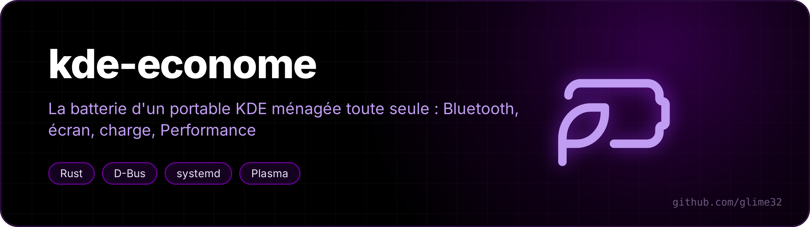
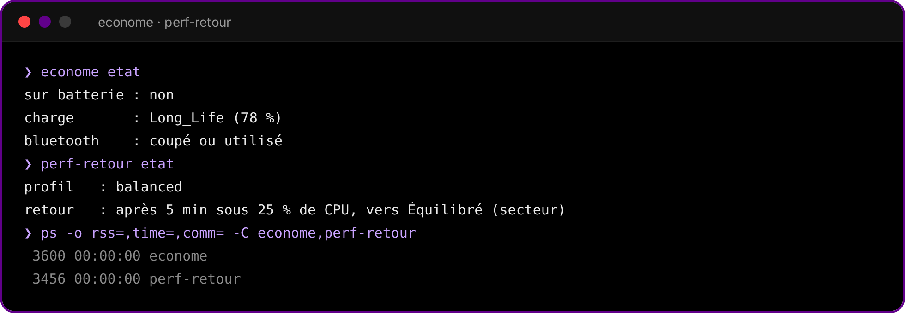

<p align="center"></p>

<p align="center">  </p>

<p align="center"><a href="README.md">🇬🇧 English version</a></p>

**Deux petits démons qui économisent la batterie d'un portable sous KDE Plasma : le Bluetooth allumé pour rien, le plafond de charge oublié, le profil Performance qu'on n'a jamais quitté. Ils dorment sur D-Bus et ne se réveillent que quand quelque chose change.**

<p align="center"></p>

## econome

- **Bluetooth** : allumé depuis 10 minutes sans aucun appareil connecté, toutes les radios Bluetooth sont coupées, comme avec le bouton de Plasma, et une notification le dit. Pour le rallumer, le bouton habituel.
- **Plafond de charge** : branché, à 99 % ou plus et hors Conservation depuis 20 minutes, la batterie repasse en Conservation (avec `batterie-mode`, plus bas), et une notification le dit. Pour le jour où tu as chargé à 100 % avant de partir et où tu as oublié de revenir.

Il attend sur le bus système (UPower, BlueZ). Ses seuls minuteurs : toutes les 5 minutes sur secteur, parce que le mode de charge n'envoie aucun signal, et l'échéance du Bluetooth quand elle est armée. Moins de 4 Mo de mémoire.

Les premières versions faisaient aussi passer l'écran en 60 Hz sur batterie et à sa fréquence la plus haute sur secteur. C'est retiré : sur le portable pour lequel il est fait, chaque changement de fréquence faisait perdre à la dalle son auto-rafraîchissement (PSR) jusqu'au redémarrage suivant, ce qui coûtait plus que la baisse de fréquence ne rapportait (mesuré au repos : 2,95 W avec le PSR, 4,08 W sans, en 60 Hz tous les deux).

## perf-retour

Performance choisi à la main, puis oublié : une fois que le processeur est resté sous 25 % pendant 5 minutes, il repasse en Équilibré sur secteur ou en Économie sur batterie, avec une notification. Un programme qui réserve Performance auprès de power-profiles-daemon (un jeu avec gamemode, par exemple) n'est pas dérangé.

Il dort sur le signal de power-profiles-daemon. Ce n'est qu'en Performance qu'il se réveille, toutes les 30 secondes, pour lire une ligne de `/proc/stat`.

## batterie-mode

`batterie-mode conservation|normal|rapide` écrit `Long_Life`, `Standard` ou `Fast` dans `/sys/class/power_supply/BAT0/charge_types` ou, si ce fichier n'existe pas, bascule l'ancien interrupteur `conservation_mode` du pilote ideapad. Il tourne en root : son installeur ajoute une règle sudo limitée à ces trois commandes exactes, et un service qui remet Conservation à chaque démarrage.

Fait sur un Lenovo Yoga 7 2-en-1 (ideapad-laptop). Un portable dont la batterie a `charge_types` devrait marcher aussi ; sinon, econome saute simplement la partie charge.

## Installation

Il faut KDE Plasma 6, power-profiles-daemon, BlueZ, UPower et Rust (`cargo`).

```bash
git clone https://github.com/glime32/kde-econome && cd kde-econome
sh installer-econome.sh
sh installer-perf-retour.sh
pkexec sh installer-batterie-mode.sh    # facultatif : la partie plafond de charge
```

Chaque installeur compile son démon, le met dans `~/.local/bin` et active un service systemd utilisateur lié à la session graphique. Relance-le avec `--retirer` pour tout enlever.

## En ligne de commande

```
econome etat                      ce qu'il voit : secteur, mode de charge, Bluetooth
perf-retour etat                  profil actuel et quand il reviendrait en arrière
```

Délais et seuils sont des variables d'environnement des services, en secondes ou en pourcentage : `ECONOME_BT_DELAI` (600), `ECONOME_PLEIN_DELAI` (1200), `PERF_RETOUR_DELAI` (300), `PERF_RETOUR_SEUIL` (25), `PERF_RETOUR_PAS` (30). Par exemple `systemctl --user edit econome.service`, puis :

```ini
[Service]
Environment=ECONOME_BT_DELAI=1200
```

La ligne de commande et les notifications sont en français.
