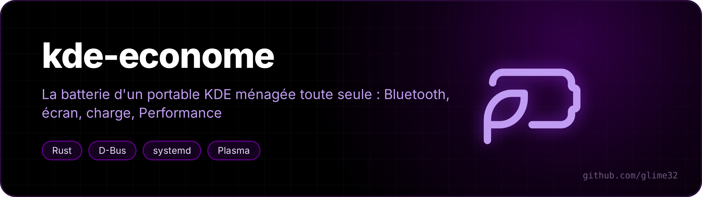
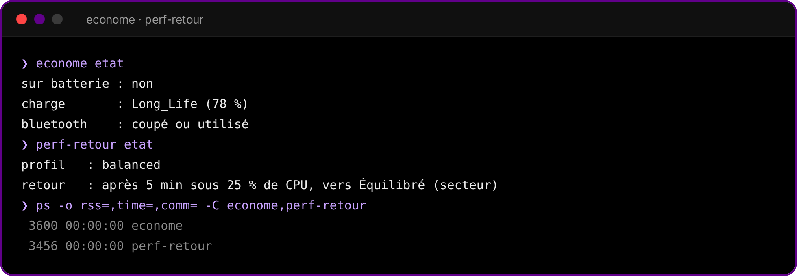

<p align="center"></p>

<p align="center">  </p>

<p align="center"><a href="README.fr.md">🇫🇷 Version française</a></p>

**Two small daemons that save battery on a KDE Plasma laptop: Bluetooth left on for nothing, a charge limit you forgot to put back, a Performance profile you forgot to leave. They sleep on D-Bus and only wake up when something changes.**

<p align="center"></p>

## econome

- **Bluetooth**: after 10 minutes switched on with no device connected, every Bluetooth radio is soft-blocked, like Plasma's own toggle, and a notification says so. Turn it back on with the usual button.
- **Charge limit**: plugged in, at 99 % or more and not in Conservation for 20 minutes, the battery goes back to Conservation (through `batterie-mode`, below), with a notification. For the day you charged to 100 % before a trip and never switched back.

It waits on the system bus (UPower, BlueZ). The only timers: every 5 minutes while on AC, since the charge mode has no change signal, and the Bluetooth deadline when it is armed. Under 4 MB of RAM.

Earlier versions also switched the screen between 60 Hz on battery and its fastest rate on AC. That part is gone: on the laptop it was made for, every change of refresh rate made the panel lose its self-refresh (PSR) until the next reboot, which cost more than the lower rate saved (measured at rest: 2.95 W with PSR, 4.08 W without, both at 60 Hz).

## perf-retour

Performance picked by hand, then forgotten: once the CPU has stayed under 25 % for 5 minutes, it goes back to Balanced on AC or Power Saver on battery, with a notification. A program that holds Performance through power-profiles-daemon (a game with gamemode, for instance) is left alone.

It sleeps on power-profiles-daemon's signal. Only while Performance is active does it wake up, every 30 seconds, to read one line of `/proc/stat`.

## batterie-mode

`batterie-mode conservation|normal|rapide` writes `Long_Life`, `Standard` or `Fast` to `/sys/class/power_supply/BAT0/charge_types`, or, when that file doesn't exist, flips the older `conservation_mode` switch of the ideapad driver. It runs as root: its installer adds a sudo rule limited to these three exact commands, and a boot service that puts Conservation back.

Made on a Lenovo Yoga 7 2-in-1 (ideapad-laptop). A laptop whose battery has `charge_types` should work too; without it, econome simply skips the charge part.

## Install

Needs KDE Plasma 6, power-profiles-daemon, BlueZ, UPower and Rust (`cargo`).

```bash
git clone https://github.com/glime32/kde-econome && cd kde-econome
sh installer-econome.sh
sh installer-perf-retour.sh
pkexec sh installer-batterie-mode.sh    # optional: the charge limit part
```

Each installer builds its daemon, puts it in `~/.local/bin` and enables a systemd user service tied to the graphical session. Run it again with `--retirer` to undo.

## Command line

```
econome etat                      what it sees: power source, charge mode, Bluetooth
perf-retour etat                  current profile and when it would go back
```

Delays and thresholds are environment variables of the services, in seconds or percent: `ECONOME_BT_DELAI` (600), `ECONOME_PLEIN_DELAI` (1200), `PERF_RETOUR_DELAI` (300), `PERF_RETOUR_SEUIL` (25), `PERF_RETOUR_PAS` (30). For example `systemctl --user edit econome.service`, then:

```ini
[Service]
Environment=ECONOME_BT_DELAI=1200
```

The command line and the notifications speak French.
